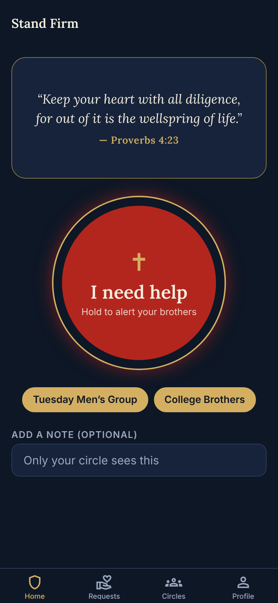

# Stand Firm

A panic button for Christian men fighting sexual temptation. Hold the button and
everyone in your accountability circle gets a notification asking them to pray
for you and reach out. They can tap **Pray** (you're notified that they're
praying) or text/call you straight from the app.

> “If a man prevails against one who is alone, two shall withstand him; and a
> threefold cord is not quickly broken.” — Ecclesiastes 4:12



## Features

- **Hold-to-send panic button** (1.5 s hold, so it can't go off by accident).
- **Circles**: create a group, share its 6-letter invite code, join others'. You
  choose which circles to alert (all by default). Anyone you trust can be in a
  circle; for a small group, just make one circle for everyone.
- **Discreet notifications**: the lock-screen text only says the person "needs
  backup" and is asking for prayer. The optional note is only visible in the app.
- **Prayer requests feed**: see who is asking, pray, text or call them.
- **"Way of escape" screen** after sending, with practical next steps and a live
  list of who is praying for you. Tap **I made it through** when it's over.
- **Rotating scripture** on the home screen (29 verses, World English Bible,
  public domain). Edit `src/lib/verses.ts` to change them.

## How it's built

| Part | Tech |
| --- | --- |
| App (iOS + Android) | Expo SDK 58, Expo Router, TypeScript |
| Accounts, database | Supabase (Postgres with row level security) |
| Push notifications | Expo push service, sent from Supabase Edge Functions |

```
src/app/                screens (Expo Router)
  (tabs)/index.tsx      home: verses + panic button
  (tabs)/alerts.tsx     prayer request feed
  (tabs)/circles.tsx    create / join / invite
  (tabs)/profile.tsx    name, phone, sign out
  sent.tsx              shown after you send an alert
  alert/[id].tsx        opened when you tap a notification
  sign-in.tsx
src/components/         hold button, verse carousel, alert card, UI kit
src/lib/                Supabase client, auth, notifications, data helpers
supabase/migrations/    database schema + security rules
supabase/functions/     send-alert, send-prayer (push notifications)
```

## Setup

You need free accounts at [supabase.com](https://supabase.com) and
[expo.dev](https://expo.dev), plus Node.js 20+.

### 1. Supabase

1. Create a new Supabase project.
2. Install the CLI (`npm i -g supabase`), then from this folder:
   ```sh
   supabase login
   supabase link --project-ref <your-project-ref>
   supabase db push                 # creates the tables and security rules
   supabase functions deploy send-alert
   supabase functions deploy send-prayer
   ```
3. Optional, for easier testing: in **Authentication → Sign In / Providers →
   Email**, turn off **Confirm email**. Otherwise new users must click the link
   in their confirmation email before signing in.

### 2. The app

```sh
npm install
cp .env.example .env.local   # paste your Supabase URL and anon key
npx eas-cli@latest init      # links an Expo project; needed for push tokens
```

Push notifications need a real device and a **development build** (Expo Go
can't receive remote notifications on Android):

```sh
npx eas-cli@latest build --profile development --platform android   # or ios
npx expo start
```

For iOS push you also need an Apple Developer account; `eas build` walks you
through creating the push key. Change `ios.bundleIdentifier` and
`android.package` in `app.json` from `com.example.standfirm` to your own first.

### 3. Try it

Sign up on two phones, create a circle on one, join it with the code on the
other, then hold the button.

## Before you release

- Proofread the verses in `src/lib/verses.ts` against a printed WEB Bible.
- The name "Life Alert" is a registered trademark of an emergency-response
  company, which is why the app is called Stand Firm here. Rename it in
  `app.json` if you like.
- Add an app icon and splash image in `assets/images/`.

## Development

```sh
npx tsc --noEmit                                          # typecheck the app
npx deno check supabase/functions/*/index.ts              # typecheck functions
```
